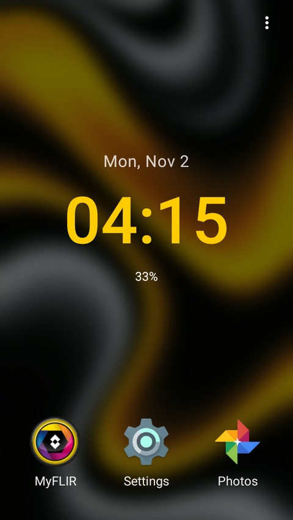

<p align="center">
  
</p>

<h1 align="center">Catloft</h1>

<p align="center">
  A minimalist home-screen launcher for <strong>CAT phones</strong> — built for the family,
  tested on a CAT S60 (Android 6.0.1).
</p>

---

**Catloft** strips the launcher down to what you actually look at: the date, the
time, the battery, and three big shortcuts. Black by default, one accent color,
no clutter. Built in pure Java with **zero dependencies** — just the Android
framework.

<p align="center">
  
</p>

## Features

- **Big clock** — date, time (12/24h follows system) and battery percentage with a
  status-bar-style indicator beside it: plain battery, a bolt while charging, the
  alert glyph at ≤ 15% (the same threshold that reddens the text).
- **Hidden status bar** — non-immersive fullscreen, so a swipe down from the
  top still opens the notification drawer.
- **3 customizable tiles** — defaults: MyFLIR (on devices that ship it), Android
  Settings, Google Photos. Tap to launch, long-press to reassign any app.
- **⋮ menu** — app drawer, change wallpaper, launcher settings. **Swipe up** on
  the home screen also opens the drawer — an optional toggle, off by default.
- **Swipe down** on the home screen opens the notification shade — optional,
  off by default, and it needs Catloft's accessibility service switched on in
  Android's own settings (Android will not let an app open the shade itself).
- **Programmable Home / Back keys** — map the Home key or Back-on-home to any
  app. Off by default: the empty mapping is today's behaviour. Home only fires
  while you are already home (so it never hijacks the key from another app).
- **Double-tap to lock** — turns the screen off from the home screen. Off by
  default; turning it on asks Android to activate Catloft as a device
  administrator (the only policy that grants is turning the screen off).
- **Portrait by default** — auto-rotation is a separate opt-in setting.
- **Wallpaper control** — pick from gallery or reuse the system wallpaper;
  dimness 0–100%, blur 0–100% (pre-rendered once; **0% is off**, anything above
  it applies to the home screen, plus an "Apply as system wallpaper" toggle).
  Default: pure black.
- **App drawer** — simple list, locale-sorted, with an **app hider**.
- **Automatic app killer** — kills *background* processes on a schedule
  (15 min – 24 h), all apps or a selected set. System apps live in their own
  list (MyFLIR preselected) under a standing red warning — clear that list and
  no system app is ever touched.
- **Color scheme** — Material palette picker with recents and an advanced
  H/S/V + hex dialog. Default `#FFCC01` (CAT yellow).
- **Slide-to-unlock** (off by default) — a ball you drag to get past, as a guard
  against buttdials. It covers Catloft itself, and other apps too once you grant
  "draw over other apps". Not a security feature: keep a system PIN.

## Build

```bash
./gradlew assembleDebug
```

Requires JDK 17 and an Android SDK (compileSdk 34; `local.properties` pins
`sdk.dir`). `minSdk`/`targetSdk` are 23, matching the Marshmallow-based CAT
phones it is built for — the one it is tested on runs 6.0.1.

## Permissions

| Permission | Why |
| --- | --- |
| `KILL_BACKGROUND_PROCESSES` | the automatic app killer |
| `SET_WALLPAPER` | "Apply as system wallpaper" (Android 6 has no separate lock wallpaper) |
| `RECEIVE_BOOT_COMPLETED` | re-arm the killer schedule after a reboot |
| `SYSTEM_ALERT_WINDOW` | the optional "lock over other apps" — nothing is ever drawn over another app until you grant it in Android's "draw over other apps" screen |
| *Accessibility service* — not a permission; you switch it on yourself in Settings → Accessibility | swipe down opens the notification shade (Android refuses to let an app do this any other way) |

## Honest limits

- The app killer uses `killBackgroundProcesses()` — background processes only,
  never force-stop. Apps with services or alarms come back later.
- Slide-to-unlock cannot block hardware keys or the notification shade, and its
  system window sits **below** the system keyguard: with a PIN/pattern set,
  Android's own lock screen still appears first, and only after it Catloft's
  ball. Keep the system lock — it is the real one.
- The Home/Back mappings are scoped by where Android hands the keys: Home only
  fires while you are already on the home screen — Home from another app still
  just brings you home (press it again there to open the mapped app), and it
  needs Catloft to be your default launcher. Back only fires while Catloft is on
  screen — inside another app, Back belongs to that app.
- After sideloading an update, switch the accessibility service off and on once
  in Settings → Accessibility: Android leaves the service listed but does not
  rebind it after the app is replaced, and the swipe-down gesture needs a live
  connection.

## Credits

**Material Design icons** by Google, used under the
[Apache License 2.0](https://www.apache.org/licenses/LICENSE-2.0) — `more_vert`,
`arrow_back`, `apps`, `wallpaper`, `settings`, `battery_full`,
`battery_charging_full` and `battery_alert`, path data taken verbatim from
[material-design-icons](https://github.com/google/material-design-icons).

## License

Personal project — no license granted.
